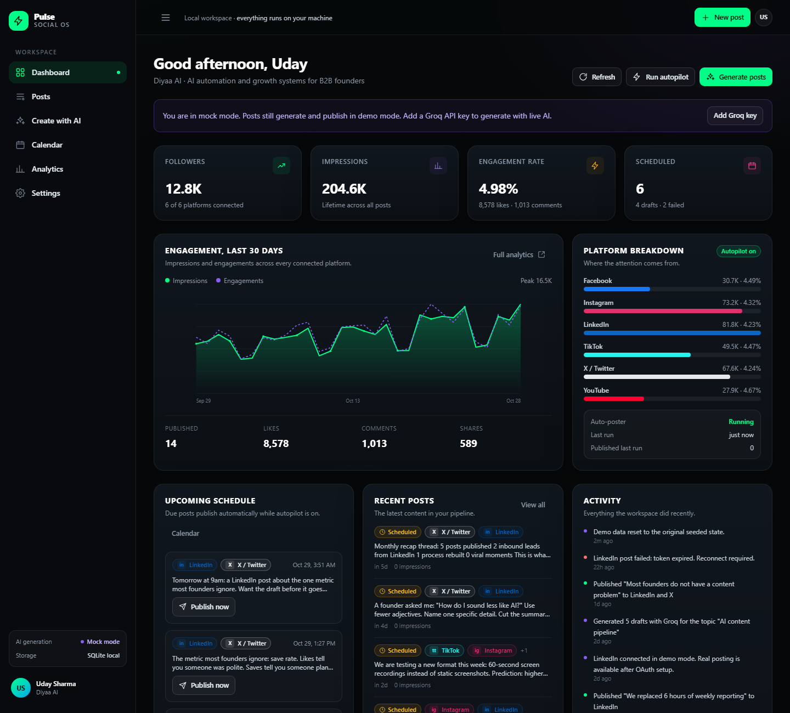

# Pulse - Local Social Media OS

A complete, local-first social media SaaS demo. Clone it, install dependencies, add a Groq API key if you want live AI, and run everything from your own computer. Posts, schedules, analytics, and settings are stored in a local SQLite database. LinkedIn auto-posting works in demo mode out of the box and can publish for real after a one-time OAuth setup.



## What you get

| Area | What works |
| --- | --- |
| Dashboard | Followers, impressions, engagement rate, schedule counts, 30-day engagement chart, platform breakdown, upcoming queue, recent posts, activity feed, one-click autopilot run |
| AI creation | Batch generate 1-10 posts by topic, tone, platform, and keywords. Editable previews. Save as drafts, schedule the batch, or publish immediately |
| Manual creation | Write a post, pick platforms, hashtags, tone, and save, schedule, or publish |
| Posts | Search and filter by status/platform, edit content and platforms, publish now, delete |
| Calendar | Month view of scheduled and published posts, day details, publish from the day panel |
| Analytics | 7/30/90-day ranges, impressions chart, platform performance table, top posts, engagement rate |
| Settings | Brand profile, Groq key, autopilot, LinkedIn auto-post toggle, platform connect/disconnect, demo reset, publish log |
| Automation | Background scheduler publishes due posts automatically while the server is running |
| LinkedIn | OAuth 2.0 connect flow, encrypted token storage, real text posting through the LinkedIn REST API, demo fallback, scheduled live auto-posting |
| Storage | Local SQLite with seeded demo data: 26 posts, 6 platform accounts, 30 days of analytics, activity history |

More screenshots: [Create](docs/screenshots/create.png) · [Settings](docs/screenshots/settings.png)

## Requirements

- Node.js **20.9 or newer** (Node 22 LTS recommended)
- npm 10+
- Windows, macOS, or Linux
- Optional: a Groq API key (free at <https://console.groq.com/keys>)
- Optional: LinkedIn developer app credentials for real LinkedIn posting

No Docker, Postgres, Redis, or external database is required.

## Quick start

```bash
git clone https://github.com/mikey21-web/socialmedia-saas.git
cd socialmedia-saas
npm install
```

Create the local environment file:

**Windows (PowerShell)**

```powershell
Copy-Item .env.example .env.local
```

**macOS / Linux**

```bash
cp .env.example .env.local
```

Start the app:

```bash
npm run dev
```

Open **<http://localhost:3000>**.

That is it. The first request creates `data/app.db`, applies the schema, and seeds the demo data. The app runs immediately in **mock AI mode** and **demo publishing mode**, so every button works without any keys.

> There is no sign-in step. This is a single-user local workspace. Open the URL and you are in.

## Add live AI generation with Groq

You can add the key in either place:

1. **In the app (easiest):** Settings -> AI generation -> paste a key starting with `gsk_` -> Save key. The key is stored in your local SQLite database.
2. **In `.env.local`:** set `GROQ_API_KEY=gsk_...` and restart. An environment key takes priority over a saved key.

Optional settings:

```env
GROQ_MODEL=openai/gpt-oss-120b
GROQ_FORCE_MOCK=false
```

The default is `openai/gpt-oss-120b`, an open-weight model hosted on Groq. You can switch `GROQ_MODEL` to any chat model your Groq account can access.

Go to **Create with AI** and generate a batch. The AI engine panel shows `Groq live` when a key is active. If Groq rejects the key or is unreachable, the app automatically falls back to the mock generator and shows a warning, so the workflow never breaks.

## LinkedIn auto-posting

### Demo mode (works now)

LinkedIn starts connected in demo mode. Scheduling a post and turning on autopilot publishes it on time and records simulated analytics. This lets you test the full flow without a LinkedIn app.

### Real LinkedIn posting (one-time setup)

1. Create an app at <https://www.linkedin.com/developers/apps>.
2. On the **Products** tab, request:
   - **Share on LinkedIn** (grants `w_member_social`)
   - **Sign In with LinkedIn using OpenID Connect** (grants `openid profile`)
3. On the **Auth** tab, add this exact redirect URL:
   ```
   http://localhost:3000/api/auth/linkedin/callback
   ```
   The URL must match exactly: same scheme, host, port, path, and no trailing slash.
4. Put the credentials in `.env.local`:
   ```env
   LINKEDIN_CLIENT_ID=your-client-id
   LINKEDIN_CLIENT_SECRET=your-client-secret
   LINKEDIN_REDIRECT_URI=http://localhost:3000/api/auth/linkedin/callback
   LINKEDIN_VERSION=202501
   ```
5. Restart the app (`Ctrl+C`, then `npm run dev`).
6. Open **Settings -> LinkedIn auto-posting -> Connect LinkedIn**, approve the scopes, and wait for the redirect back.
7. The status changes to **Live API**. New LinkedIn posts now publish for real, including scheduled auto-posts.

How auto-posting decides:

- **Autopilot** must be on (Settings -> Automation).
- **Auto-post LinkedIn on schedule** must be on (Settings -> LinkedIn).
- The scheduler checks due posts every 30 seconds while the server is running. Change this with `SCHEDULER_INTERVAL_MS`.
- Only text posts are supported. Hashtags are appended to the commentary automatically.
- Tokens are encrypted at rest with AES-256-GCM using `TOKEN_ENCRYPTION_SECRET`. Changing that secret requires reconnecting LinkedIn.
- If LinkedIn rejects a post, the failure is stored on the post, shown in the publish log, and the account metadata keeps the last error. Reconnect from Settings after fixing it.

If your LinkedIn version header is rejected (usually a `426` error), update `LINKEDIN_VERSION` to a current `YYYYMM` version and restart.

## Verify everything

With the app running (`npm run dev` or `npm start`):

```bash
npm run verify
```

This exercises the real HTTP API end to end: health, seed/reset, dashboard, filters and search, Groq mock generation, saving and clearing a local Groq key, bulk save, edit, publish, scheduled autopilot publish, analytics, profile update, account connect/disconnect, LinkedIn redirect behavior, publish log, delete, and every page render.

Last run: **71 passed, 0 failed**.

To verify the real LinkedIn OAuth and posting code without a LinkedIn account, run:

```bash
npm run build
npm run verify:linkedin
```

It starts a mock LinkedIn OAuth/API server on port 4999 and a second copy of the app on port 3100. It checks the authorization redirect, state, token exchange, userinfo, encrypted token storage, live publish payload (author, commentary, hashtags, visibility, bearer token, version header), scheduled live auto-post, publish log, and disconnect cleanup.

Last run: **34 passed, 0 failed**.

Also available:

```bash
npm run typecheck
npm run build
```

## Data and reset

- Database: `data/app.db` (created automatically, gitignored)
- Seed content: 26 posts (published, scheduled, drafts, failed), 6 accounts, 30 days of analytics, activity history
- Reset from the UI: **Settings -> Local data -> Reset demo data**
- Reset from the terminal (stop the app first):
  ```bash
  npm run db:reset
  ```
  Then start the app again to recreate and reseed the database.
- Optional: set `DATA_DIR` to use a different folder for the database.

## Project structure

```
src/
  app/
    page.tsx                 Dashboard
    posts/page.tsx           Post list, filters, edit, publish, delete
    create/page.tsx          AI batch generator and manual composer
    calendar/page.tsx        Month calendar
    analytics/page.tsx       Analytics
    settings/page.tsx        Keys, LinkedIn, automation, profile, reset
    api/                     All API routes
  components/                Shell, UI primitives, charts, icons
  lib/
    db.ts                    SQLite connection, schema, queries
    seed.ts                  Demo data
    ai.ts                    Groq client + mock generator
    linkedin.ts              OAuth, userinfo, REST publish
    publishing.ts            Multi-platform publish pipeline
    scheduler.ts             Due-post scheduler
    crypto.ts                Token encryption
scripts/
  verify.mjs                 End-to-end API verification
  verify-linkedin.mjs        Mock LinkedIn OAuth/publish verification
  reset-db.mjs               Delete the local database
docs/screenshots/            App screenshots
data/                        Generated SQLite database (gitignored)
```

The `OneDrive/` folder is an archived copy of an older full-stack prototype that is **not used** by this app. You can ignore it, or delete it to shrink the repository. The running app only uses the root `package.json`, `src/`, `scripts/`, and `data/`.

## Environment reference

```env
NEXT_PUBLIC_APP_URL=http://localhost:3000

GROQ_API_KEY=
GROQ_MODEL=openai/gpt-oss-120b
GROQ_FORCE_MOCK=false

SCHEDULER_ENABLED=true
SCHEDULER_INTERVAL_MS=30000

LINKEDIN_CLIENT_ID=
LINKEDIN_CLIENT_SECRET=
LINKEDIN_REDIRECT_URI=http://localhost:3000/api/auth/linkedin/callback
LINKEDIN_VERSION=202501
LINKEDIN_FORCE_DEMO=false

TOKEN_ENCRYPTION_SECRET=change-me-to-a-long-random-string
```

Generate a secret with:

```bash
node -e "console.log(require('crypto').randomBytes(32).toString('hex'))"
```

## Troubleshooting

**Port 3000 is already in use**

Run on another port:

```bash
npm run dev -- -p 3001
```

If you change the port, update `NEXT_PUBLIC_APP_URL` and the LinkedIn redirect URL to match.

**`better-sqlite3` fails to install**

Use Node 20 or 22 LTS, delete `node_modules` and `package-lock.json`, then run:

```bash
npm install
```

**The app says mock mode even though I added a key**

Check Settings -> AI generation for the key source. An environment key overrides a saved key. If `GROQ_FORCE_MOCK=true`, mock mode stays on. Restart after editing `.env.local`.

**Groq returns an error**

The app falls back to mock generation and shows the warning. Confirm the key at <https://console.groq.com/keys> and that the model in `GROQ_MODEL` is available to your account.

**LinkedIn says `invalid redirect_uri`**

The redirect URL in the LinkedIn app must exactly match `LINKEDIN_REDIRECT_URI`, including port and path. No trailing slash.

**LinkedIn connects but posting fails**

Confirm the app has the **Share on LinkedIn** product and the `w_member_social` scope. Disconnect and reconnect after adding products. Check the publish log and the account error in Settings.

**Scheduled posts are not publishing**

Confirm the server is running, **Autopilot** is on, and **Auto-post LinkedIn on schedule** is on. Use **Run scheduler now** to test immediately. Check the publish log for failures.

**Multiple lockfile warning**

The app lives inside a larger folder that also has a `package-lock.json` in a parent directory. The warning is harmless. Running from the project folder uses the correct dependencies.

**I want a clean start**

Stop the app, run `npm run db:reset`, then start it again. Or delete `data/app.db` manually.

## Notes and limits

- This is a local single-user demo. There is no authentication or multi-tenant isolation.
- Only LinkedIn has a real posting integration. Other platforms use realistic demo publishing and analytics.
- Analytics for published posts are simulated. The seeded 30-day history is deterministic demo data.
- LinkedIn posting is text-only and targets the connected member profile, not company pages.
- Keep `.env.local` out of version control. It is already in `.gitignore`.

